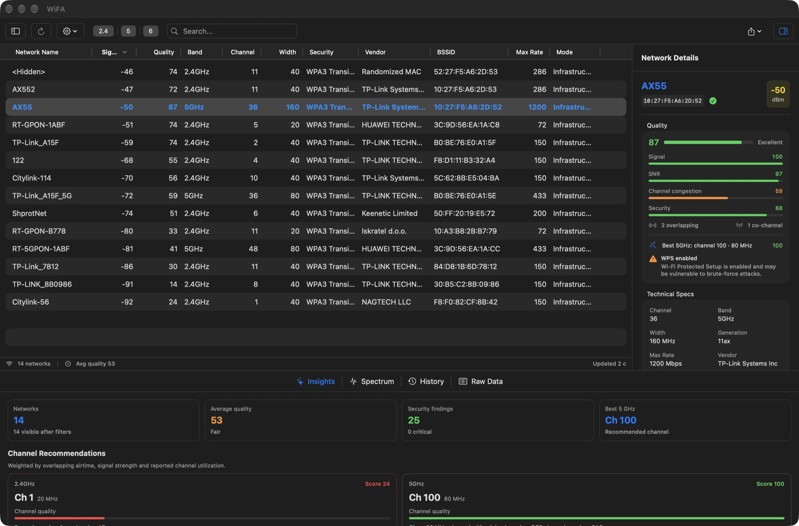
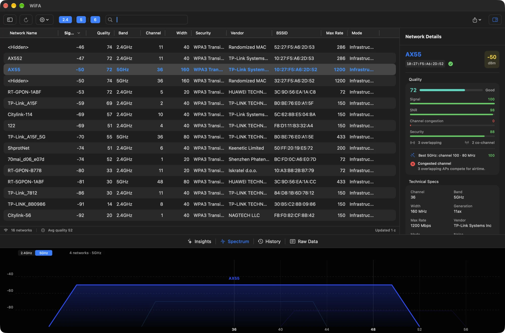

# WiFA — native macOS Wi‑Fi analyzer

[](https://github.com/zheltukheen/wifa/actions/workflows/ci.yml)
[](https://github.com/zheltukheen/wifa/releases/latest)
[](LICENSE)
[](https://www.apple.com/macos/)

WiFA is a free, open-source Wi‑Fi analyzer for macOS built on Apple's public
CoreWLAN framework. It scans nearby networks, decodes 802.11 information
elements, and turns the raw radio data into **quality scores, ranked channel
recommendations and a security audit** — the interpretation layer most free
scanners leave out.



## Why WiFA

Most analyzers show a table and leave the diagnosis to you. WiFA scores every
network from 0–100 using signal, SNR, channel overlap, reported utilization and
security posture, then recommends the quietest usable channel for each band.
Open networks, WEP, legacy WPA, WPS and missing management-frame protection are
surfaced with severity and remediation hints.

- **Native and local-first.** SwiftUI + AppKit table, no Electron, no account,
  no telemetry, no cloud.
- **Public APIs only.** Scanning uses `CWWiFiClient` / `CWNetwork`; no private
  frameworks or `airport` CLI parsing.
- **Actual analysis, not just columns.** Quality, congestion, overlap and
  security scores are unit-tested and explainable.
- **Useful defaults.** A clean table layout, persisted preferences, keyboard
  shortcuts, a menu bar extra and CSV/JSON export.

## Features

| Area | What you get |
| --- | --- |
| Scanning | Live CoreWLAN scan, Wi-Fi 4–7 generation detection, configurable interval, connected-network detection, inactive-network expiry |
| Table | Fast AppKit table, reorderable/resizable/pinnable columns, custom titles, connected-network highlight, sortable fields |
| Analysis | 0–100 quality score, signal/SNR/congestion/utilization/security sub-scores, overlap and co-channel counts |
| Channels | Ranked 2.4/5/6 GHz recommendations, 20/40/80 MHz candidates, DFS labelling, per-band spectrum chart |
| Security | Open/WEP/legacy WPA findings, WPS and PMF (802.11w) detection, severity levels and remediation text |
| Charts | Per-band spectrum view and 3-minute signal history with hover/click selection |
| Raw data | 802.11 information-element table with expandable decoded fields (RSN, WPS, HT/VHT/HE, country, BSS Load…) |
| Workflow | Search, band/signal filters, sidebar facets, Insights dashboard, menu bar extra |
| Vendors | 58k-prefix offline OUI database from IEEE and Wireshark, with 24/28/36-bit longest-prefix matching ([sources](docs/VENDOR_DATA.md)) |
| Export | CSV (visible columns, RFC 4180) and JSON (networks, metrics, issues, recommendations) |
| Privacy | No analytics, no network requests, no location stored; see [PRIVACY.md](PRIVACY.md) |



## Requirements

- macOS 13 Ventura or later (Apple Silicon and Intel)
- Location Services permission — macOS hides SSID/BSSID values from apps without it
- Xcode 16+ and [XcodeGen](https://github.com/yonaskolb/XcodeGen) only when building from source

## Install

Download the latest `.dmg` or `.zip` from
[Releases](https://github.com/zheltukheen/wifa/releases/latest), drag **WiFA** to
Applications, and launch it.

The current builds are **ad-hoc signed, not notarized**. If Gatekeeper warns,
right-click the app → **Open**, or allow it in
**System Settings → Privacy & Security**. Builds are universal (`arm64` +
`x86_64`) and include SHA-256 checksums.

On first launch, allow Location Services when macOS asks. If the prompt was
dismissed, enable it in
**System Settings → Privacy & Security → Location Services → WiFA**.

## Build from source

```bash
git clone https://github.com/zheltukheen/wifa.git
cd wifa
brew install xcodegen
xcodegen generate
./build.sh          # build/WiFA-Universal/WiFA.app (universal, ad-hoc signed)
open WiFA.xcodeproj # or develop in Xcode
```

Run the checks locally:

```bash
xcodebuild test -project WiFA.xcodeproj -scheme WiFA \
  -destination 'platform=macOS' CODE_SIGNING_ALLOWED=NO

./scripts/lint.sh
```

## How the quality score works

Each network is scored **0–100** from the sub-scores that are available:

| Component | Weight | Input |
| --- | --- | --- |
| Signal | 45% | RSSI, piecewise mapped from −95 to −50 dBm |
| SNR | 15% | Noise measurement when CoreWLAN exposes it |
| Congestion | 25% | Sum of overlapping airtime from other APs, weighted by their RSSI and channel utilization |
| Utilization | 10% | BSS Load channel utilization IE |
| Security | 10% | WPA3/OWE/WPA2/legacy/WEP/Open, PMF and WPS adjustments |

Missing sub-scores are removed and the remaining weights are renormalised.
Channel recommendations evaluate candidate 20/40/80 MHz spans against every
observed AP in the band, including partial spectral overlap, and penalise busy
channels. This is a heuristic, not a site survey: it cannot see non-Wi‑Fi
interference, airtime from clients, or spectrum analyzer data. The exact rules
live in [`Services/NetworkAnalyzer.swift`](Services/NetworkAnalyzer.swift) and
are covered by tests in [`Tests/NetworkAnalyzerTests.swift`](Tests/NetworkAnalyzerTests.swift).

## Comparison

As of October 2026, against common macOS tools:

| | WiFA | WiFi Explorer | NetSpot | Apple Wireless Diagnostics |
| --- | --- | --- | --- | --- |
| Price / license | Free, MIT | Paid | Freemium | Free |
| Native CoreWLAN scanning | ✅ | ✅ | ✅ | ✅ |
| Quality + congestion scores | ✅ | Partial | Partial | — |
| Ranked channel recommendations | ✅ | Partial | Partial | — |
| WPA3/OWE/PMF/WPS audit with remediation | ✅ | Partial | — | — |
| CSV + JSON export | ✅ | CSV/PCAP | CSV/PDF | — |
| Raw information elements | ✅ | ✅ (Pro) | — | — |
| Menu bar extra | ✅ | — | — | — |
| Site survey / heatmap | Roadmap | — | ✅ | — |
| Notarized / auto-update | Ad-hoc, roadmap | ✅ | ✅ | ✅ |

Competitor capabilities change frequently; corrections via issues are welcome.
WiFA deliberately focuses on analysis and privacy rather than heatmaps or
hardware spectrum capture.

## Roadmap

WiFA already leads on interpretation (quality, channel advice, security audit).
The remaining gap to paid analyzers is distribution, workflow and survey
features. The prioritised plan — with sources and acceptance criteria — lives in
[`docs/COMMERCIAL_GAP.md`](docs/COMMERCIAL_GAP.md).

Next up: notarized builds + Sparkle auto-updates, grouping/column profiles,
saved sessions, PCAP export, AP-name detection, MLO/EHT details, then remote
sensors and survey-lite heatmaps.

## Project structure

```text
WifiAnalyzerApp.swift        App entry, window, menu bar extra
Models/                      NetworkModel and value types
Services/
  WiFiScanner.swift          CoreWLAN scan + model construction
  InformationElementParser   Pure 802.11 IE decoding
  NetworkAnalyzer.swift      Quality, overlap, recommendations, security
ViewModels/                  @MainActor app state and preferences
Views/                       SwiftUI + AppKit table, charts, inspector, Insights
Utils/                       Location permission, OUI vendor lookup
Resources/                   OUI database, privacy manifest
Tests/                       XCTest coverage for pure logic and parsing
scripts/autopush.sh          Commit/push automation
```

`project.yml` is the source of truth for the Xcode project. Regenerate it with
`xcodegen generate` after adding or moving files.

## Automation

`scripts/autopush.sh` keeps GitHub in sync after meaningful changes:

```bash
./scripts/autopush.sh --install-hook   # push every completed commit
./scripts/autopush.sh --watch          # debounced watcher: commit + push after 90s of quiet
./scripts/autopush.sh --status
AUTOPUSH_DRY_RUN=1 ./scripts/autopush.sh
```

The script ignores build output, refuses obvious credentials and files over
10 MB, rebases/retries on a non-fast-forward push, and never force-pushes. The
installed post-commit hook skips itself while the watcher is operating.

## Release process

1. Add a `## X.Y.Z — YYYY-MM-DD` section to [`CHANGELOG.md`](CHANGELOG.md).
2. Run `./release.sh X.Y.Z`.
3. The script bumps `project.yml`, regenerates the project, commits, pushes
   `main`, and pushes tag `vX.Y.Z`.
4. GitHub Actions runs tests, builds a universal app, packages ZIP + DMG +
   SHA-256, and publishes the release using the changelog section.

## Contributing

Bug reports, feature ideas and pull requests are welcome. Read
[CONTRIBUTING.md](CONTRIBUTING.md) and [CODE_OF_CONDUCT.md](CODE_OF_CONDUCT.md)
first. Security issues should go through [SECURITY.md](SECURITY.md), not the
public issue tracker.

## License

[MIT](LICENSE) © 2025–2026 zheltukheen and WiFA contributors.

Wi-Fi, WPA2 and WPA3 are trademarks of their respective owners. WiFA is not
affiliated with Apple or the Wi-Fi Alliance.
