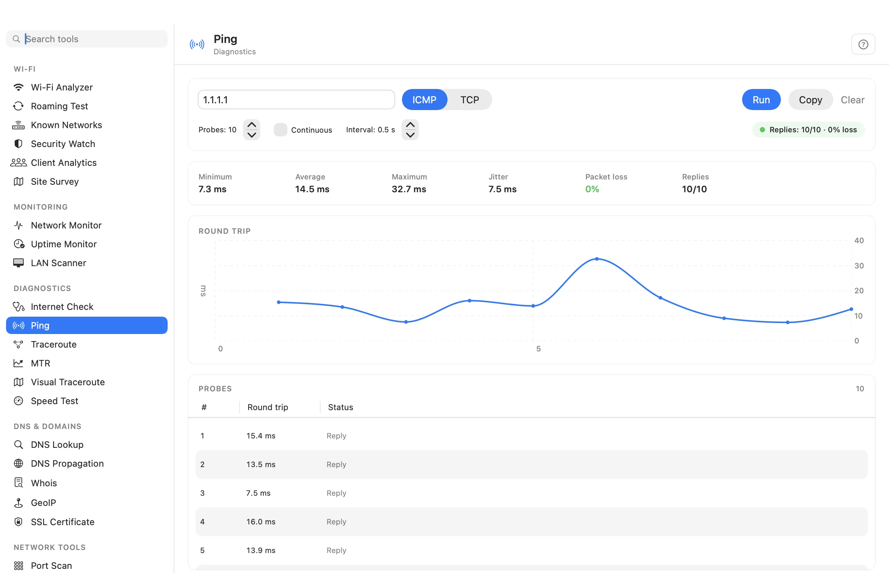
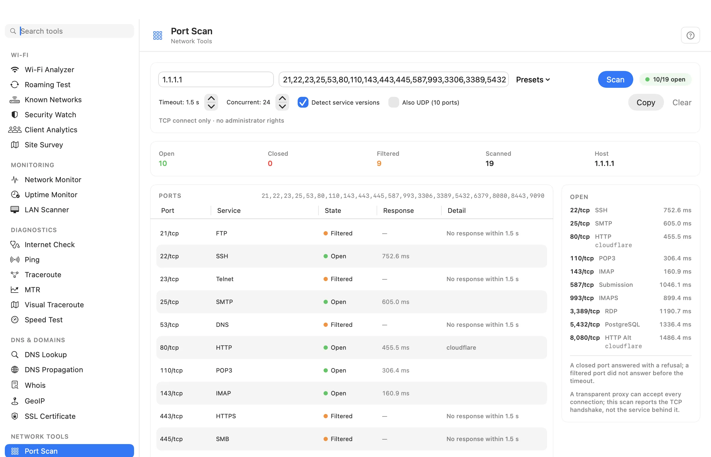
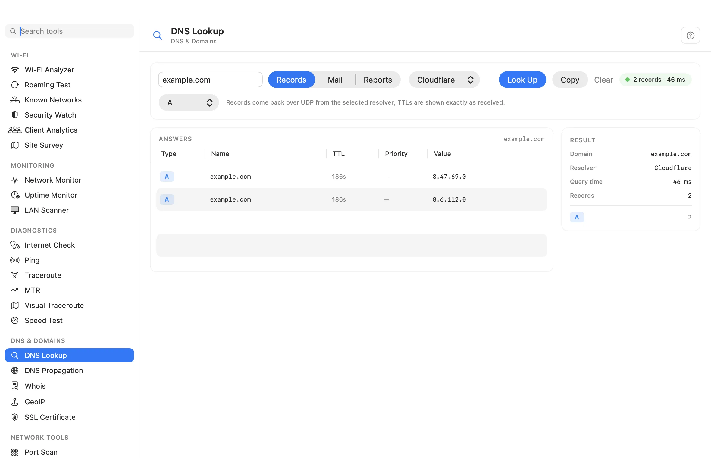
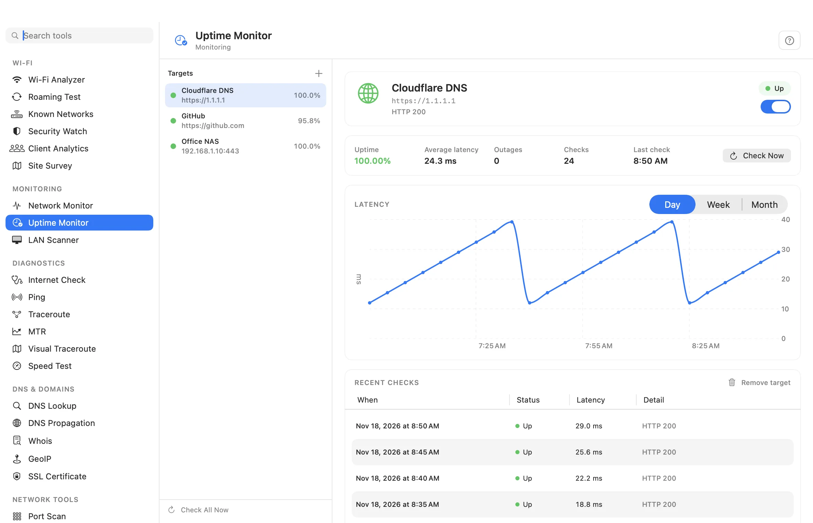

# LanFi — native macOS Wi‑Fi analyzer

[English](README.md) · [Русский](README.ru.md)


[](https://github.com/zheltukheen/lanfi/actions/workflows/ci.yml)
[](https://github.com/zheltukheen/lanfi/releases/latest)
[](LICENSE)
[](https://www.apple.com/macos/)

LanFi is a free, open-source Wi‑Fi analyzer for macOS built on Apple's public
CoreWLAN framework. It scans nearby networks, decodes 802.11 information
elements, and turns the raw radio data into **quality scores, ranked channel
recommendations and a security audit** — then proves the path end-to-end with
protocol blocks, a local network diagnostics engine and monitoring.

## Why LanFi

Most analyzers show a table and leave the diagnosis to you. LanFi scores every
network from 0–100 using signal, SNR, channel overlap, reported utilization and
security posture, then recommends the quietest usable channel for each band.
Open networks, WEP, legacy WPA, WPS and missing management-frame protection are
surfaced with severity and remediation hints.

- **Native and local-first.** SwiftUI + AppKit table, no Electron, no account,
  no telemetry, no cloud.
- **Public APIs only.** Scanning uses `CWWiFiClient` / `CWNetwork`; no private
  frameworks or `airport` CLI parsing.
- **Actual analysis, not just columns.** Quality, congestion, overlap and
  security scores are unit-tested and explainable.
- **Useful defaults.** A clean table layout, persisted preferences, keyboard
  shortcuts, a menu bar extra and CSV/JSON export.

## Features

| Area | What you get |
| --- | --- |
| Scanning | Live CoreWLAN scan, Wi-Fi 4–7 generation detection, configurable interval, connected-network detection, inactive-network expiry |
| Table | Fast AppKit table, reorderable/resizable/pinnable columns, custom titles, connected-network highlight, sortable fields |
| Analysis | 0–100 quality score, signal/SNR/congestion/utilization/security sub-scores, overlap and co-channel counts |
| Channels | Ranked 2.4/5/6 GHz recommendations, 20/40/80 MHz candidates, DFS labelling, per-band spectrum chart |
| Security | Open/WEP/legacy WPA findings, WPS and PMF (802.11w) detection, severity levels and remediation text |
| Charts | Per-band spectrum view and 3-minute signal history with hover/click selection |
| Raw data | 802.11 information-element table with expandable decoded fields (RSN, WPS, HT/VHT/HE, country, BSS Load…) |
| Workflow | Categorized bottom panel (Overview / RF / Network / Troubleshoot), Network Monitor for BSD interfaces, live + offline PCAP capture, remote SSH sensors, GPS map, column profiles, search, filters, menu bar extra |
| Protocols | Block-oriented PHY, security, roaming, spectrum, format and vendor analysis; per-network capability coverage |
| Diagnostics | Wi-Fi link, IPv4/IPv6, gateway ICMP, DNS, captive portal, HTTPS and latency checks with 60-second monitoring |
| Toolkit | One window with search and recents: Internet Check verdict, native ICMP/TCP ping, traceroute, visual traceroute, MTR, DNS lookup, DNS propagation, Whois/RDAP, GeoIP, port scan, path check, SSL certificate, subnet calculator, iperf3, speed-test history/schedule and network monitor |
| Monitoring | Wi-Fi Monitor timeline for the connected link plus all-BSSID aggregates (roaming, channel, PMF/WPS and security events, CSV, quiet-hour alerts); Route Monitor with per-hop heatmap and route-change alerts; connectivity watchdog with online/captive/offline verdicts; VPN and DNS/IPv6 leak indicators; Uptime Monitor; LAN Scanner with ARP/ICMP/TCP, Bonjour names, OUI vendors, open ports and Network Guard |
| Traffic & connections | Per-process byte totals, seven-day per-app history, contacted host names, open TCP/UDP sockets, listener watch with exposure class and change alerts |
| DNS & domains | Record types, DoH/DoT, resolver benchmark and comparison, propagation, opt-in system resolver switching with revert, Whois/RDAP and GeoIP |
| Spectrum & sensors | RF Explorer live sweep, Wi-Spy detection with Chanalyzer CSV import, remote WLAN Pi/NetAlly CSV/JSON import, interferer classification, passive BLE iBeacon/Eddystone decoding, Zigbee coexistence map, SNMP/SSDP router and NAS polling |
| Management | Editable aliases/tags/notes, grouping by SSID/band/vendor/security, saved sessions, annotations |
| Survey | Floor-plan import, click-to-sample RSSI, IDW heatmap with walls, predictive coverage, multi-floor plans, PDF reports and GPX export |
| Vendors | 58k-prefix offline OUI database from IEEE and Wireshark, with 24/28/36-bit longest-prefix matching ([sources](docs/VENDOR_DATA.md)) |
| Export | CSV, JSON, synthetic and live PCAP, HAR analysis, protocol and diagnostics reports |
| Automation | Command palette, `lanfi://` deep links, `lanfi-cli` (summary/protocols/pcap/har/mcp) and a local MCP server |
| Updates | Sparkle 2 signed appcast, Homebrew cask, universal builds |
| Privacy | No analytics/accounts/telemetry; only update and optional diagnostic requests; see [PRIVACY.md](PRIVACY.md) |









## Requirements

- macOS 13 Ventura or later (Apple Silicon and Intel)
- Location Services permission — macOS hides SSID/BSSID values from apps without it
- Xcode 16+ and [XcodeGen](https://github.com/yonaskolb/XcodeGen) only when building from source

## Install

Download the latest build directly:

- **Short link** — https://zheltukheen.github.io/lanfi/download
- **DMG** — https://github.com/zheltukheen/lanfi/releases/latest/download/LanFi.dmg
- **ZIP** — https://github.com/zheltukheen/lanfi/releases/latest/download/LanFi.zip
- **CLI** — https://github.com/zheltukheen/lanfi/releases/latest/download/LanFi-CLI.zip

Those three links always point at the newest release. Every tagged release
keeps the same unversioned names, for example
`https://github.com/zheltukheen/lanfi/releases/download/v5.6.16/LanFi.dmg`,
which stays immutable for pinning. Browse everything in
[Releases](https://github.com/zheltukheen/lanfi/releases).

Drag **LanFi** to Applications, and launch it.

The current builds are **ad-hoc signed, not notarized**. If Gatekeeper warns,
right-click the app → **Open**, or allow it in
**System Settings → Privacy & Security**. Builds are universal (`arm64` +
`x86_64`) and include SHA-256 checksums.

Or install via Homebrew:

```bash
brew tap zheltukheen/lanfi https://github.com/zheltukheen/lanfi
brew trust zheltukheen/lanfi
brew install --cask lanfi
```

Existing preferences, Sparkle updates and local annotation, session and survey
data are preserved across updates; macOS may ask for Location Services again
after an update or a bundle change.

On first launch, allow Location Services when macOS asks. If the prompt was
dismissed, enable it in
**System Settings → Privacy & Security → Location Services → LanFi**.

LanFi 1.5+ includes Sparkle auto-updates. Update checks fetch a signed appcast
from GitHub Releases; no account or analytics data is sent.

## Build from source

```bash
git clone https://github.com/zheltukheen/lanfi.git
cd lanfi
brew install xcodegen
xcodegen generate
./build.sh          # build/LanFi-Universal/LanFi.app (universal, ad-hoc signed)
open LanFi.xcodeproj # or develop in Xcode
```

Run the checks locally:

```bash
xcodebuild test -project LanFi.xcodeproj -scheme LanFi \
  -destination 'platform=macOS' CODE_SIGNING_ALLOWED=NO

./scripts/lint.sh
```

## How the quality score works

Each network is scored **0–100** from the sub-scores that are available:

| Component | Weight | Input |
| --- | --- | --- |
| Signal | 45% | RSSI, piecewise mapped from −95 to −50 dBm |
| SNR | 15% | Noise measurement when CoreWLAN exposes it |
| Congestion | 25% | Sum of overlapping airtime from other APs, weighted by their RSSI and channel utilization |
| Utilization | 10% | BSS Load channel utilization IE |
| Security | 10% | WPA3/OWE/WPA2/legacy/WEP/Open, PMF and WPS adjustments |

Missing sub-scores are removed and the remaining weights are renormalised.
Channel recommendations evaluate candidate 20/40/80 MHz spans against every
observed AP in the band, including partial spectral overlap, and penalise busy
channels. This is a heuristic, not a site survey: it cannot see non-Wi‑Fi
interference, airtime from clients, or spectrum analyzer data. The exact rules
live in [`Services/NetworkAnalyzer.swift`](Services/NetworkAnalyzer.swift) and
are covered by tests in [`Tests/NetworkAnalyzerTests.swift`](Tests/NetworkAnalyzerTests.swift).

## Comparison

Updated 21 November 2026 (LanFi 5.6.16), against common macOS tools:

| | LanFi | WiFi Explorer | NetSpot | Apple Wireless Diagnostics |
| --- | --- | --- | --- | --- |
| Price / license | Free, FSL-1.1-ALv2 | Paid (from ~$20; Pro) | Free tier; ~$19/mo or ~$179 one-time | Free |
| Native CoreWLAN scanning | ✅ | ✅ | ✅ | ✅ |
| Active, passive (monitor mode) and directed scans | ✅ | ✅ (Pro) | ✅ | Directed only |
| Quality + congestion scores | ✅ | Partial | Partial | — |
| Ranked channel recommendations | ✅ | Partial | Partial | — |
| All-band RF overview with channel overlap | ✅ | ✅ | ✅ | Partial |
| WPA3/OWE/PMF/WPS audit with remediation | ✅ | Partial | — | — |
| Evil twin, security downgrade and deauth-burst detection | ✅ | — | — | Partial |
| VPN status and DNS/IPv6 leak checks | ✅ | — | — | — |
| Gateway ARP change and DNS-hijack detection | ✅ | — | — | Partial |
| Network toolkit: ping, traceroute, MTR, DNS, ports, SSL, subnet, iperf3 | ✅ | — | Speed test only | Partial |
| DNS console: record types, DoH/DoT, resolver comparison and propagation | ✅ | — | — | Partial |
| HTTP traffic capture and HAR analysis | ✅ | — | — | — |
| NAT type and STUN reachability | ✅ | — | — | — |
| Speed test with bufferbloat grade and history | ✅ | — | ✅ | ✅ |
| Uptime Monitor, LAN Scanner, Device Shelf with risk findings and Network Guard | ✅ | — | — | — |
| Listener watch: exposure class and port-change alerts | ✅ | Partial | — | Partial |
| Persistent monitor: history, events, roaming failures and alerts | ✅ | Partial | Partial | — |
| Interfaces / gateway / DNS monitor | ✅ | Partial | — | Partial |
| Per-process traffic, open connections and per-app history | ✅ | — | Partial | — |
| Remote sensors over SSH and controller inventory (UniFi, Meraki, SNMP) | ✅ | ✅ (Pro) | — | — |
| CSV + JSON export | ✅ | CSV/PCAP | CSV/PDF | — |
| Raw information elements, EHT/MLO decoding | ✅ | ✅ (Pro) | — | Partial |
| Offline pcap/pcapng capture analysis | ✅ | ✅ | — | ✅ |
| Menu bar: live meter, alerts and connectivity state | ✅ | — | — | — |
| Site survey / heatmap | IDW + walls, predictive coverage, multi-floor, PDF, GPX | — | ✅ | — |
| Protocol blocks + diagnostics | ✅ | Partial | Partial | Partial |
| Grouping, saved sessions, annotations and column profiles | ✅ | ✅ (Pro) | Partial | — |
| Known-network inventory with Wi-Fi QR | ✅ | — | — | Partial |
| Command palette, URL scheme, CLI and MCP server | ✅ | — | — | — |
| PCAP export | Synthetic + live capture | ✅ | — | ✅ |
| Auto-update | Sparkle signed appcast | ✅ | ✅ | ✅ |
| Notarized | Roadmap | ✅ | ✅ | ✅ |

Competitor capabilities change frequently; corrections via issues are welcome.
LanFi deliberately focuses on analysis, privacy and troubleshooting rather
than predictive enterprise design. The Netutilus-style toolkit coverage and
remaining gaps are tracked in
[`docs/NETUTILUS_PARITY.md`](docs/NETUTILUS_PARITY.md).

## Roadmap

LanFi already leads on interpretation (quality, channel advice, security audit).
The remaining gap to paid analyzers is distribution, workflow and survey
features. The prioritised plan — with sources and acceptance criteria — lives in
[`docs/COMMERCIAL_GAP.md`](docs/COMMERCIAL_GAP.md). The post-parity November
2026 review is in [`docs/GAP_ANALYSIS_2026-11.md`](docs/GAP_ANALYSIS_2026-11.md);
it also carries the design track (tokens, all-band overview, table density,
menu-bar meter) that decides how the analysis above actually looks. The review
that fed it — NetWorker Pro, AirRadar 8, PeakHour 6 and an Unstore buyer's
notes — is in
[`docs/REFERENCE_APPS_REVIEW_2026-11.md`](docs/REFERENCE_APPS_REVIEW_2026-11.md).
The 22 menu-bar listings on the On My Menubar network tag are triaged in
[`docs/ONMYMENUBAR_NETWORK_REVIEW_2026-11.md`](docs/ONMYMENUBAR_NETWORK_REVIEW_2026-11.md),
which adds the P3 items (listener watch, route monitor, connectivity watchdog,
VPN leak checks, DNS benchmark, per-app history, ARP/DNS hijack, link
automation, SSH launch, plain-language services).

Delivered through 5.6.16: protocol blocks, all-interface analysis, diagnostics
with persisted monitoring history, annotations, grouping, sessions, column
profiles, multi-select, synthetic + live + offline PCAP/PCAPNG, IDW survey
heatmaps with walls, predictive coverage, multi-floor plans and PDF reports,
SSH remote sensors with polling, AP-name detection, EHT/320 MHz and Multi-Link
IE decoding, menu-bar alerts, vendor DB updates, filter profiles, CLI, URL
scheme, Sparkle, Homebrew cask, expanded localization and VoiceOver chart
descriptors, plus the Network Toolkit (verdicts, ping, traceroute, MTR, DNS,
ports, SSL, subnet, iperf3, speed-test history, Uptime Monitor and LAN
Scanner). The same line also carries listener watch, Route Monitor,
connectivity watchdog, VPN leak checks, DNS benchmark and comparison,
per-app traffic history, ARP/DNS-hijack detection, link automation, SSH
launch, plain-language services and the device shelf.

5.6.17–5.6.25 add MCP live actions and the GPS map, opt-in DNS switching with
revert, per-app domain attribution, the native ICMP probe, live capture
counters, passive BLE beacon decoding, spectrum interferer classification with
remote WLAN Pi/NetAlly import, SNMP/SSDP router polling, 802.11bn decoder
versioning, the expanded known-network inventory (live BSSID grouping, filters,
CSV/JSON export, weak-security warnings), PDF combined reports, the Shortcuts
scan-export intent, RSNXE Override decoding and material-aware survey walls
with adjustable inter-floor loss, and measured roam packet loss/reconnect time.

Remaining outside the shipped code: actual Apple notarization (no Developer
Program account/Developer ID certificate), live vendor spectrum protocols for
Wi-Spy and NetAlly (RF Explorer is live over USB-serial; the others import
CSV/URL traces), a Zigbee radio adapter, full per-link MLO BSSID sets, external
USB adapter measurement beyond CoreWLAN, the privileged `SMAppService` capture
helper and a sandboxed Mac App Store build, and a manual VoiceOver audit of the
remaining screens. Running LAN Scanner needs Local Network permission for MAC,
vendor and TCP results.

## Project structure

```text
LanFiApp.swift        App entry, window, menu bar extra
App/                         Sparkle updater and app-only glue
Models/                      NetworkModel and shared value types
Services/
  WiFiScanner.swift          CoreWLAN scan + model construction
  InformationElementParser.swift  Pure 802.11 IE decoding
  NetworkAnalyzer.swift      Quality, overlap, recommendations, security
  ProtocolAnalyzer.swift     Block-oriented protocol profile
  DiagnosticsEngine.swift    Link, gateway, DNS, internet and native ICMP checks
  LiveCaptureService.swift   tcpdump/BPF capture, authorization and validation
  PcapAnalyzer.swift         PCAP/PCAPNG decoding for captures and beacons
  RouteMonitorService.swift  Single continuous traceroute monitor
  DNSResolverSwitchService.swift  Opt-in networksetup switching and revert
  DomainAttributionService.swift  HAR and reverse-DNS host attribution
  RemoteCaptureService.swift SSH sensors and remote capture
ViewModels/                  Analyzer, diagnostics, toolkit, survey and monitor state
Views/                       SwiftUI + AppKit table, charts, toolkit, protocols, survey
Packages/LanFiCore/          SwiftPM library: typed AppSettings, ToolTarget and shared parsing
Utils/                       Location permission, OUI vendor lookup, notifications
Resources/                   OUI database, privacy manifest, five localizations
Casks/lanfi.rb               Homebrew cask (tap: zheltukheen/lanfi)
CLI/                         lanfi-cli entry point and the in-app MCP server
Tests/                       XCTest coverage for pure logic and parsing
scripts/                     Formatting, lint, UI smoke, release and autopush helpers
```

`project.yml` is the source of truth for the Xcode project. Regenerate it with
`xcodegen generate` after adding or moving files.

## Automation

`scripts/autopush.sh` keeps GitHub in sync after meaningful changes:

```bash
./scripts/autopush.sh --install-hook   # push every completed commit
./scripts/autopush.sh --watch          # debounced watcher: commit + push after 90s of quiet
./scripts/autopush.sh --status
AUTOPUSH_DRY_RUN=1 ./scripts/autopush.sh
```

The script ignores build output, refuses obvious credentials and files over
10 MB, rebases/retries on a non-fast-forward push, and never force-pushes. The
installed post-commit hook skips itself while the watcher is operating.

## Release process

1. Add a `## X.Y.Z — YYYY-MM-DD` section to [`CHANGELOG.md`](CHANGELOG.md).
2. Run `./release.sh X.Y.Z`.
3. The script bumps `project.yml`, regenerates the project, commits, pushes
   `main`, and pushes tag `vX.Y.Z`.
4. GitHub Actions runs tests, builds a universal app, packages ZIP + DMG +
   SHA-256, signs and attaches `appcast.xml`, updates the Homebrew cask and
   publishes the release using the changelog section.

## Contributing

Bug reports, feature ideas and pull requests are welcome. Read
[CONTRIBUTING.md](CONTRIBUTING.md) and [CODE_OF_CONDUCT.md](CODE_OF_CONDUCT.md)
first. Security issues should go through [SECURITY.md](SECURITY.md), not the
public issue tracker.

## License

[Functional Source License 1.1, ALv2 Future License](LICENSE)
(FSL-1.1-ALv2) © 2025–2026 zheltukheen and LanFi contributors.

LanFi is **source-available**, not OSI open source. You may use, modify and
redistribute it, but you may not offer it as a competing commercial product or
service. Internal use, non-commercial education/research and professional
services for licensed users are permitted. Each release becomes available
under Apache-2.0 on its second anniversary.

The LanFi name and logo are covered separately by [TRADEMARK.md](TRADEMARK.md).

Signed/notarized distribution is documented in [docs/DISTRIBUTION.md](docs/DISTRIBUTION.md).

Wi-Fi, WPA2 and WPA3 are trademarks of their respective owners. LanFi is not
affiliated with Apple or the Wi-Fi Alliance.

## CLI and automation

`lanfi-cli` is built with the app and published as a separate release asset:

```bash
lanfi-cli summary scan.json
lanfi-cli summary scan.json --json
lanfi-cli protocols scan.json
lanfi-cli pcap capture.pcapng --json
lanfi-cli har capture.har
lanfi-cli mcp
```

Deep links: `lanfi://toolkit/wifiAnalyzer`, `lanfi://toolkit/networkMonitor`,
`lanfi://search?q=AX55`, `lanfi://diagnostics/run` (opens Internet Check).

## Network Toolkit

Open the **Network Toolkit** from the main toolbar, or use
**Layout → Network Toolkit** (⇧⌘T). The sidebar begins with **Wi-Fi**, where
Wi-Fi Analyzer is selected by default: it summarises the current scan and hosts
Site Survey, Hardware Spectrum, Live Capture, offline capture analysis and
Remote Sensors as sheets. Monitoring, Diagnostics, DNS & Domains and Network
Tools follow.

The toolkit uses its own probe layer: unprivileged ICMP and TCP ping, DNS over
UDP, a bounded TCP port scanner, TLS chain inspection, a traceroute runner and
an iperf3 JSON client. No shell commands are parsed for ping or DNS; traceroute
still uses the setuid system binary. Deep link: `lanfi://toolkit/ping`.

MTR repeats traceroute and aggregates loss/jitter per hop. Uptime Monitor keeps
seven days of HTTP/TCP checks, notifies you on down/recovery and reports status
in the same menu bar as Wi-Fi alerts. LAN Scanner prefers the ARP table, falls
back to an ICMP/TCP sweep when macOS hides it, adds Bonjour names and OUI
vendors, and Network Guard flags new devices. Network Monitor is the toolkit's
Interfaces view; the main window no longer carries Interfaces or Diagnostics
tabs.

## Offline capture analysis

Open **Network Toolkit → Wi-Fi Analyzer → Analyze Capture** to decode
pcap/pcapng files with radiotap or bare 802.11 frames. Beacon/probe-response SSID, BSSID, channel,
RSSI, security and EHT presence are shown offline; no network is contacted.

## Remote sensors

Open **Network Toolkit → Wi-Fi Analyzer → Remote Sensors**, add a Mac with
Remote Login enabled and an authorized SSH key, then run a scan. Password prompts are not supported.
