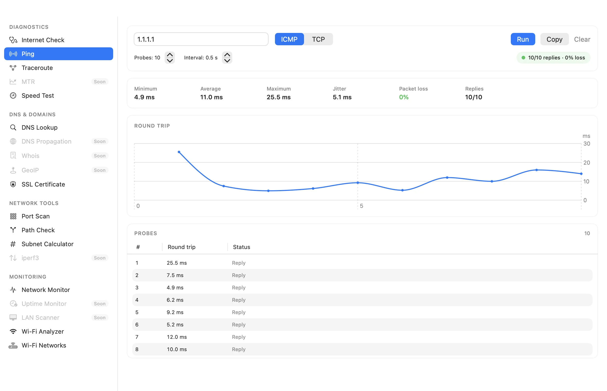
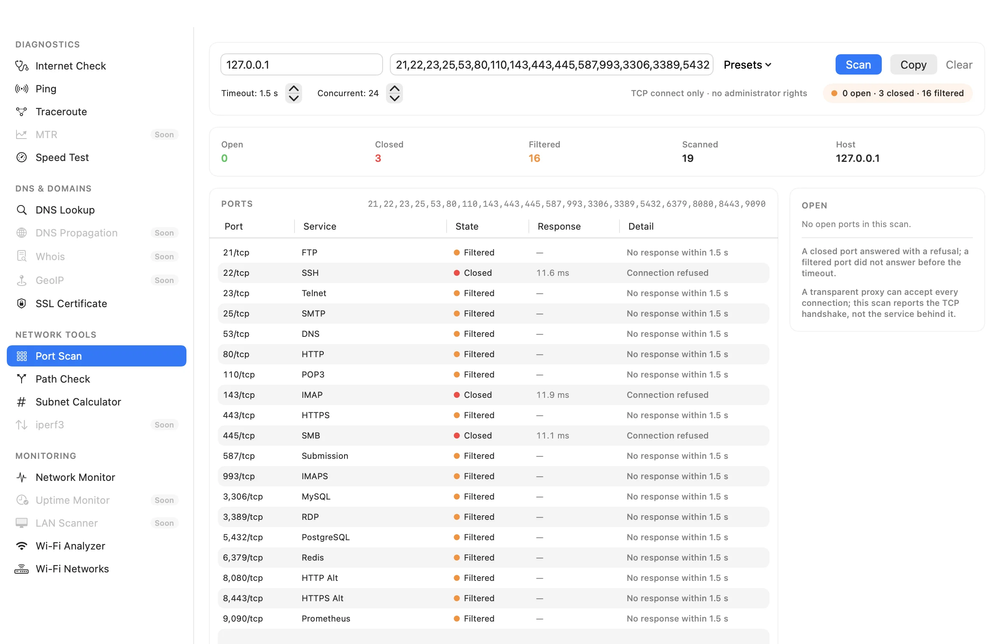
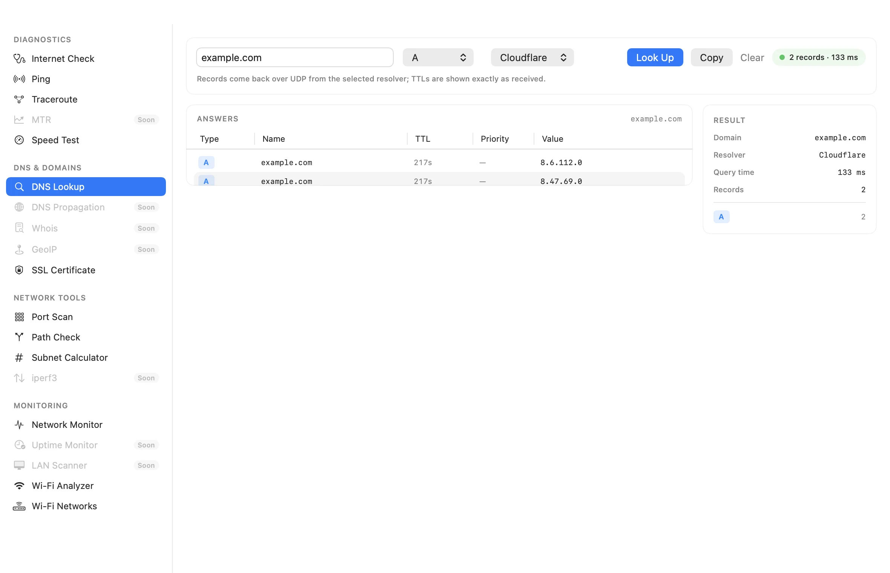
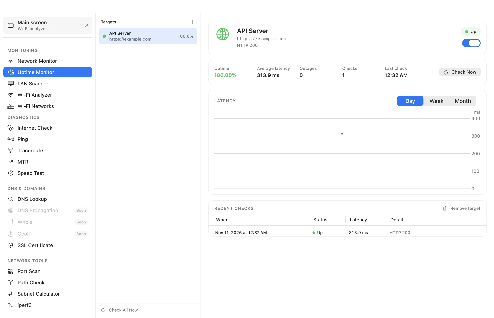

# LanFi — нативный анализатор Wi‑Fi для macOS

[English](README.md) · [Русский](README.ru.md)


[](https://github.com/zheltukheen/lanfi/actions/workflows/ci.yml)
[](https://github.com/zheltukheen/lanfi/releases/latest)
[](LICENSE)
[](https://www.apple.com/macos/)

LanFi — бесплатный анализатор Wi‑Fi для macOS с доступным исходным кодом,
построенный на публичном фреймворке Apple CoreWLAN. Он сканирует сети рядом,
декодирует информационные элементы 802.11 и превращает сырые радиоданные в
**оценку качества, ранжированные рекомендации каналов и аудит безопасности**,
а затем проверяет весь путь: блоки протоколов, локальную диагностику и
мониторинг.

## Почему LanFi

Большинство анализаторов показывают таблицу и оставляют диагноз вам. LanFi
оценивает каждую сеть от 0 до 100 по сигналу, SNR, перекрытию каналов,
заявленной загрузке и безопасности, а затем рекомендует самый свободный
рабочий канал для каждого диапазона. Открытые сети, WEP, устаревший WPA, WPS и
отсутствие защиты управляющих кадров показываются с уровнем серьёзности и
подсказками по исправлению.

- **Нативно и локально.** SwiftUI + таблица AppKit, без Electron, аккаунтов,
  телеметрии и облака.
- **Только публичные API.** Сканирование через `CWWiFiClient` / `CWNetwork`;
  без приватных фреймворков и разбора вывода `airport`.
- **Настоящий анализ, а не только колонки.** Оценки качества, загруженности,
  перекрытия и безопасности покрыты тестами и объяснимы.
- **Удобные настройки по умолчанию.** Аккуратная таблица, сохранение
  предпочтений, горячие клавиши, иконка в строке меню и экспорт CSV/JSON.

## Возможности

| Область | Что даёт |
| --- | --- |
| Сканирование | Живое сканирование CoreWLAN, определение Wi‑Fi 4–7, настраиваемый интервал, определение подключённой сети, истечение неактивных сетей |
| Таблица | Быстрая таблица AppKit, перетаскивание/изменение ширины/закрепление колонок, свои заголовки, подсветка подключённой сети, сортировка |
| Анализ | Оценка качества 0–100, подоценки сигнала/SNR/загруженности/утилизации/безопасности, число перекрытий и совпадающих каналов |
| Каналы | Ранжированные рекомендации для 2.4/5/6 ГГц, кандидаты 20/40/80 МГц, пометки DFS, график спектра по диапазонам |
| Безопасность | Находки по открытым сетям/WEP/старому WPA, определение WPS и PMF (802.11w), уровни серьёзности и текст исправлений |
| Графики | Спектр по диапазонам и история сигнала за 3 минуты с наведением и выбором |
| Сырые данные | Таблица информационных элементов 802.11 с раскрываемыми декодированными полями (RSN, WPS, HT/VHT/HE, страна, BSS Load…) |
| Рабочий процесс | Категории нижней панели (Overview / RF / Network), профили колонок, поиск, фильтры, иконка в строке меню |
| Протоколы | Блочный анализ PHY, безопасности, роуминга, спектра, формата и вендора; покрытие возможностей по каждой сети |
| Диагностика | Wi‑Fi-линк, IPv4/IPv6, ICMP до шлюза, DNS, captive portal, HTTPS и задержка с мониторингом каждые 60 секунд |
| Тулкит | Одно окно с поиском и недавними: вердикт Internet Check, нативный ICMP/TCP ping, traceroute, визуальный traceroute, MTR, DNS lookup, распространение DNS, Whois/RDAP, GeoIP, сканирование портов, Path Check, SSL-сертификат, калькулятор подсетей, iperf3, история и расписание speed-тестов, монитор сети |
| Мониторинг | Uptime Monitor для HTTP/TCP-целей с уведомлениями и статусом в строке меню; LAN Scanner с ARP/ICMP/TCP, именами Bonjour, вендорами OUI, открытыми портами и Network Guard |
| Управление | Редактируемые псевдонимы/теги/заметки, группировка по SSID/диапазону/вендору/безопасности, сохранённые сеансы, аннотации |
| Обследование | Импорт плана помещения, запись RSSI по клику и тепловая карта (упрощённое обследование) |
| Вендоры | Офлайн-база OUI на 58 тыс. префиксов из IEEE и Wireshark с поиском по самому длинному префиксу 24/28/36 бит ([источники](docs/VENDOR_DATA.md)) |
| Экспорт | CSV, JSON и синтетический PCAP beacon-кадров 802.11 для офлайн-разбора |
| Обновления | Подписанный appcast Sparkle 2, Homebrew cask, universal-сборки |
| Приватность | Без аналитики/аккаунтов/телеметрии; только обновления и опциональные диагностические запросы; см. [PRIVACY.md](PRIVACY.md) |









## Требования

- macOS 13 Ventura или новее (Apple Silicon и Intel)
- Разрешение Location Services — без него macOS скрывает SSID/BSSID
- Xcode 16+ и [XcodeGen](https://github.com/yonaskolb/XcodeGen) только для сборки из исходников

## Установка

Скачайте последнюю сборку:

- **Короткая ссылка** — https://zheltukheen.github.io/lanfi/download
- **DMG** — https://github.com/zheltukheen/lanfi/releases/latest/download/LanFi.dmg
- **ZIP** — https://github.com/zheltukheen/lanfi/releases/latest/download/LanFi.zip
- **CLI** — https://github.com/zheltukheen/lanfi/releases/latest/download/LanFi-CLI.zip

Эти ссылки всегда указывают на самый новый релиз. В каждом релизе сохраняются
одинаковые имена без версии, например
`https://github.com/zheltukheen/lanfi/releases/download/v4.12.0/LanFi.dmg`,
поэтому их можно закреплять. Все релизы — в
[Releases](https://github.com/zheltukheen/lanfi/releases).

Перетащите **LanFi** в Applications и запустите.

Текущие сборки **подписаны ad-hoc и не нотаризованы**. Если Gatekeeper
предупреждает, нажмите на приложение правой кнопкой → **Open** или разрешите его
в **System Settings → Privacy & Security**. Сборки universal (`arm64` +
`x86_64`) и содержат контрольные суммы SHA-256.

Или установите через Homebrew:

```bash
brew tap zheltukheen/lanfi https://github.com/zheltukheen/lanfi
brew trust zheltukheen/lanfi
brew install --cask lanfi
```

LanFi — новое имя приложения. Существующие настройки,
обновления Sparkle и локальные данные аннотаций/сеансов/обследований
переносятся автоматически; macOS может снова запросить Location Services. Если
установлены обе версии, удалите старый `LanFi.app`.

При первом запуске разрешите Location Services. Если запрос был отклонён,
включите доступ в
**System Settings → Privacy & Security → Location Services → LanFi**.

LanFi 1.5+ поддерживает автообновление Sparkle. Проверка обновлений получает
подписанный appcast из GitHub Releases; аккаунт и аналитика не отправляются.

## Сборка из исходников

```bash
git clone https://github.com/zheltukheen/lanfi.git
cd lanfi
brew install xcodegen
xcodegen generate
./build.sh          # build/LanFi-Universal/LanFi.app (universal, ad-hoc signed)
open LanFi.xcodeproj # или разработка в Xcode
```

Локальные проверки:

```bash
xcodebuild test -project LanFi.xcodeproj -scheme LanFi \
  -destination 'platform=macOS' CODE_SIGNING_ALLOWED=NO

./scripts/lint.sh
```

## Как считается оценка качества

Каждая сеть получает **0–100** из доступных подоценок:

| Компонент | Вес | Входные данные |
| --- | --- | --- |
| Сигнал | 45% | RSSI, кусочно отображается от −95 до −50 dBm |
| SNR | 15% | Измерение шума, когда CoreWLAN его отдаёт |
| Загруженность | 25% | Сумма перекрывающегося эфирного времени других AP с учётом их RSSI и загрузки канала |
| Утилизация | 10% | IE загрузки канала BSS Load |
| Безопасность | 10% | WPA3/OWE/WPA2/legacy/WEP/Open, поправки PMF и WPS |

Отсутствующие подоценки убираются, оставшиеся веса нормализуются. Рекомендации
каналов проверяют кандидатов 20/40/80 МГц против каждого наблюдаемого AP в
диапазоне, включая частичное спектральное перекрытие, и штрафуют занятые
каналы. Это эвристика, а не обследование площадки: она не видит не-Wi‑Fi помехи, эфирное
время клиентов и данные спектроанализатора. Точные правила — в
[`Services/NetworkAnalyzer.swift`](Services/NetworkAnalyzer.swift), тесты — в
[`Tests/NetworkAnalyzerTests.swift`](Tests/NetworkAnalyzerTests.swift).

## Сравнение

По состоянию на ноябрь 2026, с распространёнными инструментами для macOS:

| | LanFi | WiFi Explorer | NetSpot | Apple Wireless Diagnostics |
| --- | --- | --- | --- | --- |
| Цена / лицензия | Бесплатно, FSL-1.1-ALv2 | Платно (от ~$20; Pro) | Бесплатный тариф; ~$19/мес или ~$179 разово | Бесплатно |
| Нативное сканирование CoreWLAN | ✅ | ✅ | ✅ | ✅ |
| Оценки качества и загруженности | ✅ | Частично | Частично | — |
| Ранжированные рекомендации каналов | ✅ | Частично | Частично | — |
| Аудит WPA3/OWE/PMF/WPS с исправлениями | ✅ | Частично | — | — |
| Сетевой тулкит: ping, traceroute, MTR, DNS, порты, SSL, подсети, iperf3 | ✅ | — | Только speed test | Частично |
| Uptime Monitor + LAN Scanner + Network Guard | ✅ | — | — | — |
| Мониторинг интерфейсов / шлюза / DNS | ✅ | Частично | — | Частично |
| Удалённые сенсоры по SSH | ✅ | ✅ (Pro) | — | — |
| Экспорт CSV + JSON | ✅ | CSV/PCAP | CSV/PDF | — |
| Сырые информационные элементы | ✅ | ✅ (Pro) | — | — |
| Иконка в строке меню | ✅ | — | — | — |
| Обследование помещений / тепловая карта | IDW + затухание стен | — | ✅ | — |
| Блоки протоколов + диагностика | ✅ | Частично | Частично | Частично |
| Группировка, сохранённые сеансы, аннотации | ✅ | ✅ (Pro) | Частично | — |
| Экспорт PCAP | Синтетический + живой захват | ✅ | — | ✅ |
| Автообновление | Подписанный appcast Sparkle | ✅ | ✅ | ✅ |
| Нотаризация | В планах | ✅ | ✅ | ✅ |

Возможности конкурентов меняются; исправления через issues приветствуются.
LanFi сознательно фокусируется на анализе, приватности и диагностике, а не на
предиктивном enterprise-проектировании. Покрытие в стиле Netutilus и
оставшиеся пробелы — в
[`docs/NETUTILUS_PARITY.md`](docs/NETUTILUS_PARITY.md).

## Планы

LanFi уже лидирует в интерпретации (качество, советы по каналам, аудит
безопасности). Оставшийся разрыв с платными анализаторами — распространение,
рабочий процесс и обследование. Приоритетный план с источниками и критериями
готовности — в [`docs/COMMERCIAL_GAP.md`](docs/COMMERCIAL_GAP.md).

Реализовано к 4.12.1: блоки протоколов, анализ всех интерфейсов, диагностика с
сохранённой историей мониторинга, аннотации, группировка, сеансы, профили
колонок, мультивыбор, синтетический + живой + офлайн PCAP/PCAPNG, IDW-тепловые
карты со стенами и PDF-отчётами, удалённые SSH-сенсоры с опросом, определение
имени AP, декодирование EHT/320 МГц и Multi-Link IE, оповещения в строке меню,
обновление базы вендоров, профили фильтров, CLI, URL-схема, Sparkle, Homebrew
cask, расширенная локализация и VoiceOver-описания графиков, а также сетевой
тулкит (вердикты, ping, traceroute, MTR, DNS, порты, SSL, подсети, iperf3,
история speed-тестов, Uptime Monitor и LAN Scanner).

Вне готового кода остаются: фактическая нотаризация Apple (нет аккаунта
Developer Program и сертификата Developer ID), интеграция аппаратного
спектроанализатора, полные наборы BSSID по линкам MLO, измерение через внешний
USB-адаптер beyond CoreWLAN и ручной аудит VoiceOver оставшихся экранов. DNS Propagation, Whois/RDAP, GeoIP и Visual Traceroute уже реализованы; для
MAC, вендора и TCP-результатов LAN Scanner нужно разрешение Local Network.
Мультивыбор и массовое редактирование, динамическая техническая
локализация, анализ PCAPNG/офлайн, обновление базы вендоров, CLI, URL-автоматизация,
оповещения, отчёты обследования и общие настройки приложения реализованы.

## Структура проекта

```text
LanFiApp.swift               Точка входа, окно, иконка в строке меню
Models/                      NetworkModel и типы значений
Services/
  WiFiScanner.swift          Сканирование CoreWLAN + построение модели
  InformationElementParser   Чистое декодирование IE 802.11
  NetworkAnalyzer.swift      Качество, перекрытие, рекомендации, безопасность
  ProtocolAnalyzer.swift     Блочный профиль протоколов
  DiagnosticsEngine.swift    Проверки линка, шлюза, DNS, интернета и задержки
  PcapExporter.swift         Экспорт синтетического PCAP beacon-кадров
  NetworkColumnFormatter.swift  Чистое форматирование/сортировка таблицы
ViewModels/                  Состояние анализатора, диагностики и обследования
Views/                       SwiftUI + таблица AppKit, графики, протоколы, диагностика, обследование
Utils/                       Разрешение Location, поиск вендора по OUI
Resources/                   База OUI, privacy manifest, русская локализация
Casks/lanfi.rb                Homebrew cask (tap: zheltukheen/lanfi)
CLI/LanFiCLI.swift            Офлайн CLI-цель (lanfi-cli)
Tests/                       XCTest для чистой логики и парсинга
scripts/autopush.sh          Автоматизация commit/push
```

`project.yml` — источник истины для Xcode-проекта. После добавления или
перемещения файлов выполните `xcodegen generate`.

## Автоматизация

`scripts/autopush.sh` синхронизирует GitHub после значимых изменений:

```bash
./scripts/autopush.sh --install-hook   # пушить каждый завершённый commit
./scripts/autopush.sh --watch          # watcher: commit + push после 90 секунд тишины
./scripts/autopush.sh --status
AUTOPUSH_DRY_RUN=1 ./scripts/autopush.sh
```

Скрипт игнорирует артефакты сборки, отказывается от очевидных учётных данных и
файлов больше 10 MB, делает rebase/retry при non-fast-forward push и никогда не
делает force-push. Установленный post-commit hook не срабатывает, пока работает
watcher.

## Процесс релиза

1. Добавьте секцию `## X.Y.Z — YYYY-MM-DD` в [`CHANGELOG.md`](CHANGELOG.md).
2. Запустите `./release.sh X.Y.Z`.
3. Скрипт обновляет `project.yml`, пересоздаёт проект, коммитит, пушит `main` и
   тег `vX.Y.Z`.
4. GitHub Actions запускает тесты, собирает universal-приложение, упаковывает
   ZIP + DMG + SHA-256, подписывает и прикрепляет `appcast.xml`, обновляет
   Homebrew cask и публикует релиз с описанием из changelog.

## Участие

Сообщения об ошибках, идеи и pull request приветствуются. Сначала прочитайте
[CONTRIBUTING.md](CONTRIBUTING.md) и [CODE_OF_CONDUCT.md](CODE_OF_CONDUCT.md).
Проблемы безопасности — через [SECURITY.md](SECURITY.md), а не в публичный
issue-трекер.

## Лицензия

[Functional Source License 1.1, ALv2 Future License](LICENSE)
(FSL-1.1-ALv2) © 2025–2026 zheltukheen и участники LanFi.

LanFi — **source-available**, а не OSI open source. Вы можете использовать,
изменять и распространять его, но не можете предлагать как конкурирующий
коммерческий продукт или сервис. Внутреннее использование, некоммерческое
образование/исследования и профессиональные услуги для лицензированных
пользователей разрешены. Каждый релиз становится доступен под Apache-2.0 через
два года.

Название и логотип LanFi отдельно покрываются [TRADEMARK.md](TRADEMARK.md).

Подписанная/нотаризованная дистрибуция описана в [docs/DISTRIBUTION.md](docs/DISTRIBUTION.md).

Wi‑Fi, WPA2 и WPA3 — товарные знаки соответствующих владельцев. LanFi не
связан с Apple или Wi-Fi Alliance.

## CLI и автоматизация

`lanfi-cli` собирается вместе с приложением и публикуется отдельным релизным
ассетом:

```bash
lanfi-cli summary scan.json
lanfi-cli summary scan.json --json
lanfi-cli protocols scan.json
lanfi-cli pcap capture.pcapng --json
```

Deep links: `lanfi://toolkit/wifiAnalyzer`, `lanfi://toolkit/networkMonitor`,
`lanfi://search?q=AX55`, `lanfi://diagnostics/run` (открывает Internet Check).

## Сетевой тулкит

Откройте **Network Toolkit** из главного тулбара или через
**Layout → Network Toolkit** (⇧⌘T). Sidebar начинается с **Wi-Fi**, где по
умолчанию выбран Wi‑Fi Analyzer: он показывает сводку текущего сканирования и
содержит Site Survey, Hardware Spectrum, Live Capture, офлайн-анализ захвата и
Remote Sensors в виде листов. Далее идут Monitoring, Diagnostics, DNS & Domains
и Network Tools.

Тулкит использует собственный слой проб: непривилегированный ICMP и TCP ping,
DNS поверх UDP, сканер TCP-портов с ограничением конкурентности, проверку
TLS-цепочки, runner traceroute и JSON-клиент iperf3. Для ping и DNS не
разбирается вывод shell-команд; traceroute всё ещё использует setuid-бинарник
системы. Deep link: `lanfi://toolkit/ping`.

MTR повторяет traceroute и агрегирует потери/джиттер по хопам. Uptime Monitor
хранит семь дней проверок HTTP/TCP, уведомляет о падении/восстановлении и
показывает статус в той же строке меню, что и Wi‑Fi-оповещения. LAN Scanner
предпочитает ARP-таблицу, при её недоступности делает ICMP/TCP-обход, добавляет
имена Bonjour и вендоров OUI, а Network Guard отмечает новые устройства.
Network Monitor — это встроенный экран интерфейсов тулкита; в главном окне
больше нет вкладок Interfaces и Diagnostics.

## Офлайн-анализ захвата

Откройте **Network Toolkit → Wi-Fi Analyzer → Analyze Capture**, чтобы
декодировать pcap/pcapng с radiotap или чистыми кадрами 802.11. SSID/BSSID,
канал, RSSI, безопасность и наличие EHT для beacon/probe-response показываются
офлайн; сеть не используется.

## Удалённые сенсоры

Откройте **Network Toolkit → Wi-Fi Analyzer → Remote Sensors**, добавьте Mac с
включённым Remote Login и разрешённым SSH-ключом, затем запустите сканирование.
Запрос пароля не поддерживается.
